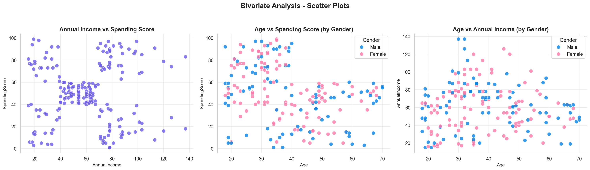
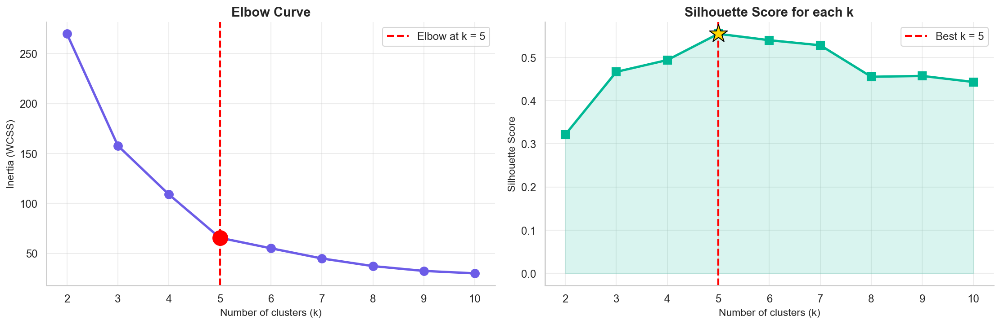
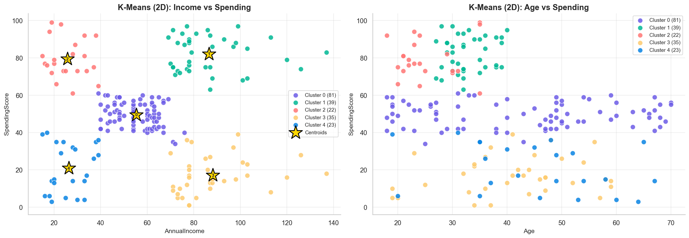
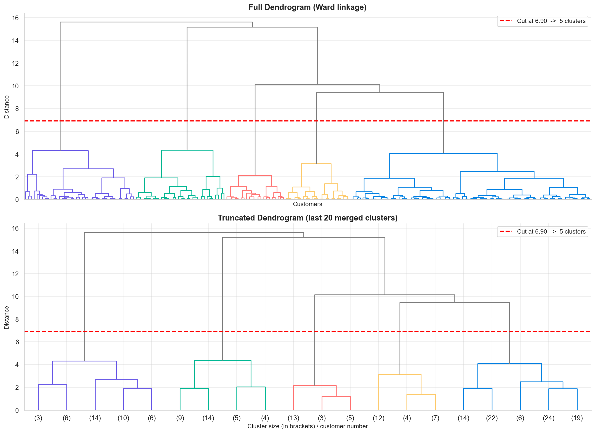
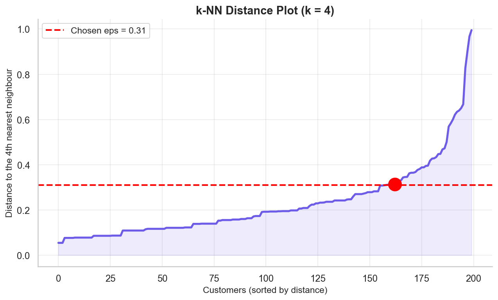
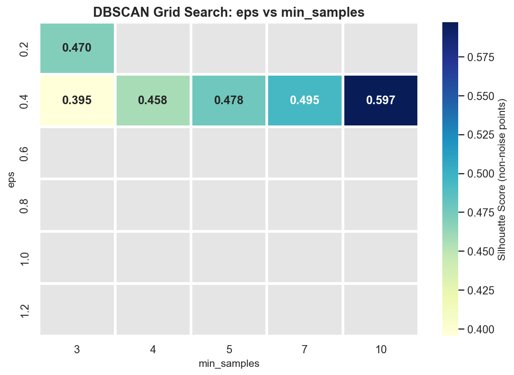

# 🛍️ Mall Shopper Profiling — Unsupervised Learning

Customer segmentation of mall visitors using **K-Means**, **Agglomerative Hierarchical Clustering** and **DBSCAN**, translated into actionable retail personas and strategies.

> Practical Exam · Unsupervised Learning (Set B) — Red & White Skill Education

---

## 📌 Project Overview
A large Indian mall chain (think *Phoenix Marketcity* or *Nexus Malls*) wants to understand the spending behaviour of its visitors so it can **redesign store layouts, plan targeted promotional events and offer personalised loyalty rewards**.

This project explores the data, engineers features, applies three clustering algorithms, evaluates them with internal metrics, and converts the clusters into **shopper personas with concrete business strategies**. A saved scaler + model and a `classify_shopper()` function can tag new shoppers in real time.

## 📂 Dataset
**Mall Customer Segmentation Data** (Kaggle) — 200 customers, 5 columns: `CustomerID`, `Genre`, `Age`, `Annual Income (k$)`, `Spending Score (1–100)`.

🔗 <https://www.kaggle.com/datasets/vjchoudhary7/customer-segmentation-tutorial-in-python>

Download `Mall_Customers.csv` and keep it in the project root folder.

## 🗂️ Repository Structure
```
mall-shopper-segmentation-unsupervised-learning/
├── MallShopperSegmentation_UnsupervisedLearning.ipynb   # full analysis (EDA → clustering → deployment)
├── Mall_Customers.csv                                   # dataset (from Kaggle)
├── mall_scaler.pkl                                      # saved StandardScaler
├── mall_segmentation_model.pkl                          # saved final K-Means model
├── summary_report.md                                    # ~1-page results summary
├── requirements.txt                                     # Python dependencies
├── images/                                              # figures saved by the notebook
└── README.md
```

## ⚙️ Setup & How to Run
```bash
# 1. Clone the repository
git clone https://github.com/<your-username>/mall-shopper-segmentation-unsupervised-learning.git
cd mall-shopper-segmentation-unsupervised-learning

# 2. (Optional) create a virtual environment
python -m venv venv
source venv/bin/activate          # Windows: venv\Scripts\activate

# 3. Install dependencies
pip install -r requirements.txt
pip install notebook              # only if Jupyter is not already installed

# 4. Launch the notebook and run all cells
jupyter notebook MallShopperSegmentation_UnsupervisedLearning.ipynb
```
Running the notebook top-to-bottom regenerates all figures (`images/`), `mall_scaler.pkl`, `mall_segmentation_model.pkl` and `summary_report.md`.

## 🧪 Methodology
| Step | What was done |
|------|---------------|
| 1. EDA | Data inspection, histograms, boxplots, outliers (IQR), scatter plots, correlation heatmap, gender-wise summary |
| 2. Feature engineering | Label-encoded gender; `IncomeGroup`, `AgeGroup`, `SpendingCategory`; `StandardScaler` on 2D and multi-feature sets |
| 3. K-Means | Elbow method + silhouette score, final model (2D and 4-feature), PCA visualisation, cluster profiling and personas |
| 4. Hierarchical | Ward dendrogram with automatic cut line, ward/complete/average comparison, agreement with K-Means |
| 5. DBSCAN | k-NN distance plot for ε, 30-model grid search (ε × min_samples), noise-shopper profiling |
| 6. Comparison | Silhouette, Davies-Bouldin and Calinski-Harabasz for all three algorithms, K-Means stability across 5 seeds, business recommendation |
| 7. Deployment | Saved scaler + model with `joblib`, `classify_shopper()` tested on 5 new shoppers |

## 👥 Shopper Personas
| Persona | Profile | Suggested strategy |
|---------|---------|--------------------|
| **Big Spenders** | High income, high spending — the premium core | Premium lounge and luxury-brand pop-ups near the food court |
| **Careful Spenders** | High income, low spending — wealthy but frugal | Quality/warranty-led messaging and personalised app offers |
| **Mainstream Shoppers** | Medium income, medium spending — everyday "Westside-type" shoppers, the largest group | Mid-range brand zones near the atrium, seasonal sales, family bundles |
| **Young Aspirers** | Low income, very high spending — young and trend-driven | Youth zone with fast fashion, gaming, cafés, student discounts and UPI cashback |
| **Budget Shoppers** | Low income, low spending — deal seekers | Value stores near entrances, ₹50-off coupons and BOGO offers via the mall app |

*(Exact cluster sizes and averages are printed in the notebook and in `summary_report.md`.)*

## 🖼️ Screenshots
| | |
|---|---|
|  |  |
|  |  |
|  |  |

## 🔮 Classify a New Shopper
```python
import joblib, pandas as pd

scaler = joblib.load("mall_scaler.pkl")
model = joblib.load("mall_segmentation_model.pkl")

new = pd.DataFrame([[30, 85]], columns=["AnnualIncome", "SpendingScore"])   # income in k$, score 1-100
print(model.predict(scaler.transform(new))[0])                              # cluster id
```
The full `classify_shopper()` function (which also returns the persona name) is in Step 7.1 of the notebook.

## 🛠️ Tech Stack
Python · pandas · NumPy · scikit-learn · SciPy · matplotlib · seaborn · plotly · joblib

## 👤 Author
**Your Name** — [GitHub](https://github.com/<your-username>)
